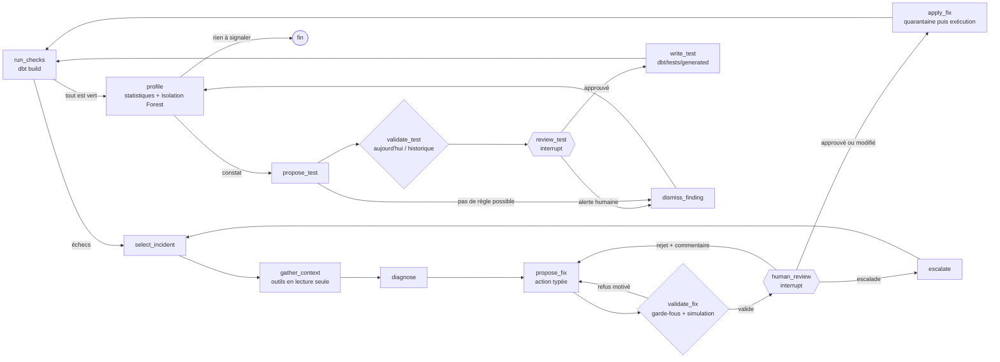

<p align="right"><a href="./README.md">English</a> | <b>Français</b></p>

<h1 align="center">Agent IA de qualité de données</h1>

<p align="center">
  <a href="https://www.python.org"></a>
  <a href="https://www.getdbt.com"></a>
  <a href="https://duckdb.org"></a>
  <a href="https://langchain-ai.github.io/langgraph/"></a>
  <a href="https://ollama.com"></a>
  <a href="https://scikit-learn.org"></a>
  <a href="LICENSE"></a>
</p>

> **Un agent LangGraph qui surveille un pipeline dbt : il trouve la cause des tests en échec, propose une correction SQL, la fait valider par un humain, l'applique et relance les tests. Quand tout est vert, il cherche aussi les anomalies qu'aucun test ne prévoit et propose les tests manquants.**

Un pipeline de données casse rarement en silence : un fichier arrive avec une colonne renommée, un lot est chargé deux fois, un capteur envoie des altitudes impossibles. Les tests dbt le signalent, mais il faut encore comprendre la cause et corriger, et les tests ne voient que les erreurs qu'on a prévues. Ce projet automatise ce travail sur des données réelles de trafic aérien (OpenSky Network, vols touchant la France en avril 2020), sans jamais rien modifier sans accord humain, et mesure ce que l'agent réussit vraiment sur 13 types d'anomalies injectées.

<p align="center">
  <a href="#résultats">Résultats</a> ·
  <a href="#fonctionnement">Fonctionnement</a> ·
  <a href="#évaluation">Évaluation</a> ·
  <a href="#données">Données</a> ·
  <a href="#démarrage">Démarrage</a> ·
  <a href="#serveur-mcp">Serveur MCP</a> ·
  <a href="#utiliser-lagent-sur-un-autre-projet-dbt">Autre projet dbt</a>
</p>

<p align="center">
  
</p>

---

## Résultats

<!-- RESULTS:START -->
<!-- RESULTS:END -->

---

## Fonctionnement

L'agent est un graphe LangGraph à deux boucles. La **boucle de correction** part d'un test dbt en échec. La **boucle de surveillance** démarre quand tous les tests passent : un profil statistique cherche ce que les tests ne voient pas, et chaque constat peut devenir un nouveau test, après accord humain.



**Boucle de correction**

1. **Pipeline dbt sur DuckDB.** Zone `raw` (vols et aéroports) → vues `staging` typées → tables `marts` (vols enrichis, trafic journalier par aéroport français). 4 modèles et 28 tests : `not_null`, `unique`, `accepted_values`, `relationships`, et 4 tests personnalisés (`in_range` pour les mesures physiques, `unique_combination`, deux tests de cohérence de dates).
2. **Détection.** `run_checks` lance `dbt build` puis lit `run_results.json` et `manifest.json` : test en échec, colonne, nombre de lignes, et lignage de la colonne vers la table `raw` (déclaré dans les `meta` dbt, ou déduit du graphe dbt).
3. **Contexte.** Des outils en lecture seule rassemblent les lignes en échec (tables `store_failures` de dbt), les lignes `raw` correspondantes, le contrat de schéma des sources, le schéma réel et le profil des colonnes. Le LLM reçoit une vue compacte (environ 1 200 tokens).
4. **Diagnostic.** Classement de l'incident (valeurs manquantes, doublons, valeurs aberrantes, dérive de schéma, incohérence de dates, intégrité référentielle, format) et colonnes `raw` en cause, en JSON structuré.
5. **Correction.** Le LLM choisit une **action typée** (recalculer, inverser deux colonnes, mettre à NULL, normaliser un code, dédoublonner, renommer une colonne, supprimer des lignes, SQL libre, escalader) ; le SQL est généré à partir de ce choix. Les noms de colonnes sont contraints par un schéma JSON construit à partir du schéma réel, et les noms staging glissés par erreur sont traduits en expressions `raw` grâce au SQL des modèles dbt.
6. **Garde-fous.** Une seule instruction `UPDATE`, `DELETE` ou `ALTER TABLE ... RENAME COLUMN`, sur une table source déclarée dans dbt, avec `WHERE`, jamais sur `_row_id`, au plus 10 % des lignes. La correction est simulée dans une transaction annulée ; une erreur, une proposition déjà refusée ou une couverture incomplète des lignes en échec est renvoyée au raisonneur, qui réessaie (3 tentatives au plus).
7. **Validation humaine.** Le graphe s'arrête (`interrupt`) et montre le diagnostic, le SQL et un aperçu avant/après. L'humain approuve, rejette avec un commentaire (transmis à l'agent), modifie le SQL ou escalade. Avec un checkpointer SQLite, une exécution interrompue se reprend plus tard (`dq run --resume <id>`).
8. **Application et vérification.** Les lignes touchées sont copiées en JSON dans `audit.quarantine`, la correction est exécutée en transaction, puis `dbt build` est relancé. Chaque étape est écrite dans `logs/decisions.jsonl` (lisible avec `dq audit` ou DuckDB).

**Boucle de surveillance**

9. **Profil de référence.** À chaque version validée des données, le profileur enregistre pour chaque colonne le taux de NULL, la plage de valeurs, la casse, la longueur et les catégories connues, et entraîne un **Isolation Forest par paire de colonnes numériques** (seuil calé sur les 1 % de lignes les plus isolées).
10. **Constats.** Quand tous les tests passent, il compare les données actuelles à ce profil : volume, hausse des NULL, valeurs hors plage, nouvelle casse ou longueur, nouvelles catégories, et excès de combinaisons inhabituelles (plus de 4 écarts-types au-dessus du hasard). Sur les données propres, il ne signale rien.
11. **Nouveau test.** L'agent transforme un constat en test dbt (une condition SQL qui sélectionne les lignes fautives). Avant de la montrer, il la mesure sur les données actuelles et sur l'historique validé. L'humain l'ajoute, la rejette, la modifie ou en fait une alerte. Un test accepté est écrit dans `dbt/tests/generated/`, puis la boucle de correction prend le relais. Les constats qui ne peuvent pas devenir une règle ligne par ligne (volume, taux de NULL, combinaisons inhabituelles) deviennent des **alertes** pour un humain.

**Trois raisonneurs, interchangeables.** `rules` applique une remédiation générique par type de test (référence sans LLM, utilisée par la CI) ; `ollama` utilise un LLM local (par défaut `qwen2.5-coder:7b`, aucune donnée ne sort de la machine) ; `hybrid` essaie d'abord la règle, puis passe la main au LLM si la règle est refusée ou absente. Claude est disponible par l'API (`anthropic`, `hybrid:anthropic`, modèle `claude-opus-5-5`).

---

## Évaluation

Chaque scénario part d'une référence propre, injecte une anomalie avec une graine fixe et écrit l'état attendu après une bonne correction. L'agent tourne ensuite de bout en bout, face à un **relecteur simulé** : il applique la correction proposée dans une transaction annulée et ne l'accepte que si les données obtenues sont exactement celles attendues. Un test proposé n'est accepté que s'il signale toutes les lignes injectées et aucune ligne de l'historique validé. Sinon le relecteur rejette, avec un commentaire du type de celui qu'un humain ferait (« 45 lignes supprimées alors qu'elles pouvaient être réparées »), sans donner la solution.

**8 anomalies que les tests dbt voient**

| Scénario | Catégorie | Anomalie injectée | Bonne correction |
|---|---|---|---|
| `missing_flight_date` | valeurs manquantes | `day` à NULL | recalculer depuis `lastseen` |
| `missing_aircraft_id` | valeurs manquantes | `icao24` à NULL | mettre les lignes en quarantaine |
| `duplicate_rows` | doublons | lot rechargé | supprimer les copies |
| `altitude_outlier` | valeurs aberrantes | 99 999 m ou erreur d'unité | mettre la mesure à NULL |
| `schema_drift_rename` | dérive de schéma | colonne renommée | renommer la colonne |
| `swapped_timestamps` | incohérence de dates | `firstseen` et `lastseen` inversés | les inverser à nouveau |
| `flight_date_shift` | incohérence de dates | `day` décalé d'un jour | recalculer depuis `lastseen` |
| `lowercase_airport_codes` | intégrité référentielle | codes OACI en minuscules | les remettre en majuscules |

**5 anomalies qu'aucun test dbt ne voit**

| Scénario | Anomalie injectée | Bonne issue |
|---|---|---|
| `typecode_lowercase` | types d'avion en minuscules | nouveau test, puis remise en majuscules |
| `future_timestamps` | vols datés 10 ou 20 ans dans le futur | nouveau test, puis quarantaine |
| `swapped_coordinates` | latitude et longitude de départ inversées | alerte (Isolation Forest) |
| `typecode_null_spike` | type d'avion manquant sur 40 à 60 % des vols au lieu de 27 % | alerte |
| `volume_drop` | 30 à 50 % des vols absents | alerte |

Indicateurs : **diagnostic** juste (catégorie) ; **corrections acceptées** sur corrections soumises au relecteur ; **incident résolu** (tests verts et données exactement restaurées) ; **bonne issue** pour les anomalies sans test (réparée, ou alerte quand c'est irréparable) ; **taux d'automatisation** (bonne issue obtenue avec la première proposition, sans rejet, modification ni escalade) ; **latence** de la prise en charge de l'incident jusqu'aux tests repassés, hors temps du relecteur, sur un Mac Apple M4 (16 Go).

**Limites.** Le relecteur est simulé : il connaît la vérité terrain, ce qu'un humain n'a pas. Les anomalies sont injectées une par une et restent proches de cas d'école. Le raisonneur à base de règles a été écrit par l'auteur des scénarios : c'est une référence haute sur les cas qu'il couvre, pas un adversaire neutre. Les descriptions des colonnes sources (par exemple « `day` vaut toujours `CAST(lastseen AS DATE)` ») sont lues par le LLM et jouent un rôle réel dans ses bons diagnostics. Le LLM local est un modèle de 7 milliards de paramètres ; un modèle plus grand ou Claude ferait sans doute mieux, mais ce n'est pas mesuré ici.

---

## Données

- **Vols** : *Crowdsourced air traffic data from The OpenSky Network 2020*, fichier d'avril 2020 (Zenodo, [10.5281/zenodo.7923702](https://doi.org/10.5281/zenodo.7923702)), filtré sur les 7 626 vols qui partent d'un aéroport français ou y arrivent.
- **Aéroports** : [OurAirports](https://ourairports.com/data/) (domaine public), 86 293 aéroports.

La licence OpenSky autorise l'usage pour l'enseignement et la recherche à but non lucratif, mais **interdit la redistribution** : les données ne sont pas dans ce dépôt, `dq download` les récupère à la source. Les identifiants d'avions (`icao24`) et les indicatifs des vols privés sont **pseudonymisés** à l'ingestion par un hachage salé avec une clé locale, et l'immatriculation n'est pas conservée. La CI travaille sur des vols synthétiques.

**Ce que les tests ont trouvé dans les vraies données.** Avant toute injection, 5 tests échouent sur 57 vols (0,7 %) : 34 codes d'aéroport absents du référentiel (anciens codes comme EDDT pour Berlin-Tegel), 17 vols de plus de 20 heures (traces de plusieurs vols mises bout à bout) et 6 altitudes au-delà de 16 km. Ces lignes sont mises de côté, avec leur motif, dans `audit.baseline_exclusions` : c'est la référence propre de l'évaluation (`dq ingest --no-certify` les garde pour essayer l'agent sur de vraies anomalies).

> Matthias Schäfer, Martin Strohmeier, Vincent Lenders, Ivan Martinovic, Matthias Wilhelm. *Bringing up OpenSky: A large-scale ADS-B sensor network for research.* IPSN 2014. Données : The OpenSky Network, https://opensky-network.org

---

## Démarrage

Prérequis : [uv](https://docs.astral.sh/uv/) et, pour le LLM local, [Ollama](https://ollama.com).

```bash
git clone https://github.com/Yvngval/dq-agent.git && cd dq-agent
uv sync
ollama pull qwen2.5-coder:7b        # LLM local (4,7 Go)
make data ingest check              # téléchargement, chargement, dbt build : tout est vert
make demo                           # injecte une anomalie et lance l'agent ; tu valides dans le terminal
```

Sans téléchargement ni LLM : `make synthetic`, puis `PYTHONPATH=src uv run dq run --provider rules`.

| Commande | Rôle |
|---|---|
| `dq inject --list` | Liste les 13 scénarios ; `dq inject <scénario> --seed N` en injecte un |
| `dq run [--provider rules\|ollama\|hybrid\|anthropic]` | Lance l'agent avec validation dans le terminal |
| `dq profile` | Compare les données au profil de référence, sans rien modifier |
| `dq evaluate --provider ollama --seeds 5 [--suite v1\|v2]` | Évalue l'agent face au relecteur simulé |
| `dq report` | Écrit `reports/RESULTS.md` |
| `dq audit` | Affiche le journal des décisions |
| `dq graph` | Affiche le graphe LangGraph au format Mermaid |
| `make test` | Tests pytest (données synthétiques) |

Pour Claude : copier `.env.example` en `.env`, mettre `DQ_LLM_PROVIDER=anthropic` (ou `hybrid:anthropic`) et fournir la clé dans `ANTHROPIC_API_KEY`.

---

## Serveur MCP

`dq mcp` démarre un serveur [MCP](https://modelcontextprotocol.io) en lecture seule, utilisable depuis Claude Desktop ou Claude Code : `list_tables`, `describe_table`, `source_contract` (écart entre le contrat et le schéma réel), `test_results` (dernier `dbt build`), `failing_rows`, `column_profile`, `profile_findings` (anomalies sans test), `decisions` (journal de l'agent) et `quarantine`.

```json
{"mcpServers": {"dq-agent": {"command": "uv", "args": ["run", "--directory", "/chemin/vers/dq-agent", "dq", "mcp"],
                             "env": {"PYTHONPATH": "/chemin/vers/dq-agent/src"}}}}
```

---

## Utiliser l'agent sur un autre projet dbt

Rien dans le code de l'agent ne parle de vols : les tables qu'il a le droit de corriger sont les **sources déclarées dans dbt**, l'ordre de traitement vient du **graphe dbt**, et la seule description du domaine donnée au LLM est une variable dbt. Pour un autre projet sur DuckDB, il faut :

1. **des tests dbt**, c'est-à-dire les détecteurs : l'agent corrige ce que les tests voient, et le profileur repère ce qu'ils ne voient pas ;
2. **les colonnes des sources décrites** dans le YAML dbt (le contrat de schéma et sa documentation, que le LLM lit) ;
3. **le lignage des colonnes** des modèles staging (`meta: {source_table, source_columns}`), sinon l'agent remonte à la source unique en amont ;
4. **une colonne technique `_row_id`** dans chaque table source (quarantaine, dédoublonnage, aperçu) ;
5. la variable `dq_agent.domain` dans `dbt_project.yml`.

Les scénarios d'anomalies et le relecteur simulé, eux, sont propres à ce jeu de vols : ils servent à mesurer l'agent, pas à le faire fonctionner. Seul DuckDB est pris en charge pour l'instant.

---

## Structure du projet

```text
dbt/                    projet dbt : sources (contrat), staging, marts, tests personnalisés et générés
src/dq_agent/
  ingest.py             chargement OpenSky + OurAirports, pseudonymisation, référence propre
  anomalies.py          13 scénarios d'anomalies reproductibles et leur vérité terrain
  dbt_runner.py         dbt build, lecture de run_results.json, du lignage et du graphe dbt
  context.py            outils de contexte en lecture seule
  reasoners.py          raisonneurs : règles, LLM (actions typées ou SQL libre), hybride
  actions.py            actions de correction typées et génération du SQL
  guardrails.py         analyse SQL, simulation, quarantaine, application
  profiler.py           profil de référence, constats statistiques, Isolation Forest
  monitoring.py         des constats aux tests dbt : validation, écriture
  graph.py              graphe LangGraph et boucles de validation humaine
  review.py             relecteurs : terminal, simulé (évaluation)
  evaluate.py           évaluation chiffrée
  mcp_server.py         serveur MCP en lecture seule
tests/                  tests pytest (données synthétiques)
reports/                résultats d'évaluation (JSONL) et RESULTS.md ; reports/v1/ : première version
```

## Contribuer

Les issues et pull requests sont les bienvenues. Voir [CONTRIBUTING.md](CONTRIBUTING.md).

## Licence

Le code est publié sous [licence MIT](LICENSE). Les données OpenSky restent soumises à la licence de l'OpenSky Network ; OurAirports est dans le domaine public.

## Auteur

<a href="https://github.com/Yvngval"></a>

Valentin Ponnoussamy ([@Yvngval](https://github.com/Yvngval)), Master Données, Connaissances et Intelligence, Université Paris Cité, 2026.
