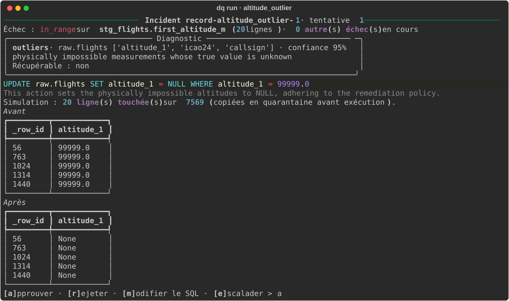
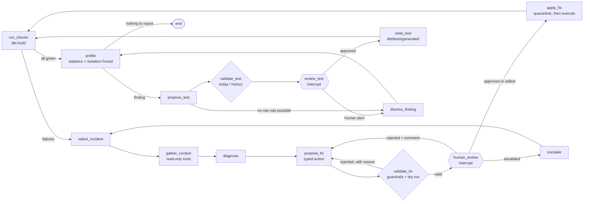
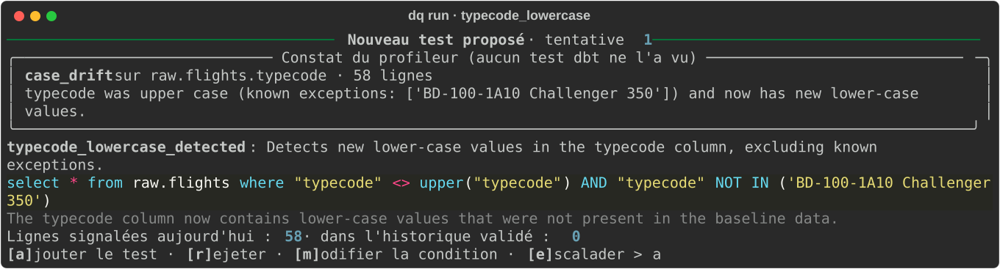

<p align="right"><b>English</b> | <a href="./README.fr.md">Français</a></p>

<h1 align="center">Data Quality AI Agent</h1>

<p align="center">
  <a href="https://www.python.org"></a>
  <a href="https://www.getdbt.com"></a>
  <a href="https://duckdb.org"></a>
  <a href="https://langchain-ai.github.io/langgraph/"></a>
  <a href="https://ollama.com"></a>
  <a href="https://scikit-learn.org"></a>
  <a href="LICENSE"></a>
</p>

> **A LangGraph agent that watches a dbt pipeline: it finds the root cause of failing tests, proposes a SQL fix, has a human approve it, applies it and re-runs the tests. When everything is green, it also looks for anomalies no test anticipates and proposes the missing tests.**

Data pipelines rarely break silently: a file arrives with a renamed column, a batch is loaded twice, a sensor reports impossible altitudes. dbt tests flag it, but someone still has to understand the cause and fix it, and tests only catch the errors someone thought of. This project automates that work on real air traffic data (OpenSky Network, flights touching France in April 2020), never changes anything without human approval, and measures what the agent actually gets right on 13 kinds of injected anomalies.

<p align="center">
  <a href="#results">Results</a> ·
  <a href="#how-it-works">How it works</a> ·
  <a href="#evaluation">Evaluation</a> ·
  <a href="#data">Data</a> ·
  <a href="#getting-started">Getting started</a> ·
  <a href="#mcp-server">MCP server</a> ·
  <a href="#using-the-agent-on-another-dbt-project">Another dbt project</a>
</p>

<p align="center">
  
</p>

---

## Results

<!-- RESULTS:START -->
<!-- RESULTS:END -->

---

## How it works

The agent is a LangGraph graph with two loops. The **repair loop** starts from a failing dbt test. The **monitoring loop** starts when every test passes: a statistical profile looks for what the tests miss, and each finding can become a new test once a human agrees.



**Repair loop**

1. **dbt pipeline on DuckDB.** `raw` landing zone (flights and airports) → typed `staging` views → `marts` tables (enriched flights, daily traffic per French airport). 4 models and 28 tests: `not_null`, `unique`, `accepted_values`, `relationships`, and 4 custom tests (`in_range` for physical measurements, `unique_combination`, two date-consistency tests).
2. **Detection.** `run_checks` runs `dbt build`, then reads `run_results.json` and `manifest.json`: failing test, column, row count, and the column's lineage back to the `raw` table (declared in dbt `meta`, or inferred from the dbt graph).
3. **Context.** Read-only tools gather the failing rows (dbt `store_failures` tables), the matching `raw` rows, the source schema contract, the actual schema and column profiles. The LLM gets a compact view (about 1,200 tokens).
4. **Diagnosis.** The incident is classified (missing values, duplicates, outliers, schema drift, date inconsistency, referential integrity, format) and the `raw` columns at fault are named, as structured JSON.
5. **Fix.** The LLM picks a **typed action** (recompute, swap two columns, set to NULL, normalise a code, deduplicate, rename a column, delete rows, free SQL, escalate); the SQL is generated from that choice. Column names are constrained by a JSON schema built from the actual schema, and staging names used by mistake are translated into `raw` expressions using the dbt models' SQL.
6. **Guardrails.** A single `UPDATE`, `DELETE` or `ALTER TABLE ... RENAME COLUMN` statement, on a source table declared in dbt, with a `WHERE` clause, never touching `_row_id`, on at most 10% of the rows. The fix is dry-run in a rolled-back transaction; an error, a proposal already rejected or incomplete coverage of the failing rows goes back to the reasoner, which tries again (3 attempts at most).
7. **Human review.** The graph stops (`interrupt`) and shows the diagnosis, the SQL and a before/after preview. The human approves, rejects with a comment (passed to the agent), edits the SQL or escalates. With a SQLite checkpointer, an interrupted run can be resumed later (`dq run --resume <id>`).
8. **Apply and verify.** Affected rows are copied as JSON to `audit.quarantine`, the fix runs in a transaction, then `dbt build` runs again. Every step is written to `logs/decisions.jsonl` (readable with `dq audit` or DuckDB).

**Monitoring loop**

9. **Reference profile.** For each validated version of the data, the profiler records each column's NULL rate, value range, letter case, length and known categories, and trains an **Isolation Forest per pair of numeric columns** (threshold set on the 1% most isolated reference rows).
10. **Findings.** When every test passes, it compares the current data with that profile: volume, NULL increase, out-of-range values, new case or length, new categories, and an excess of unusual combinations (more than 4 standard deviations above chance). On clean data it reports nothing.
11. **New test.** The agent turns a finding into a dbt test (a SQL condition selecting the faulty rows), measures it on today's data and on the validated history, and shows it to the human, who adds, rejects, edits it or turns it into an alert. An accepted test is written to `dbt/tests/generated/`, then the repair loop takes over. Findings that cannot become a row-level rule (volume, NULL rate, unusual combinations) become **alerts** for a human.

<p align="center">
  
</p>

**Three interchangeable reasoners.** `rules` applies one generic remediation per test type (no-LLM baseline, used by CI); `ollama` uses a local LLM (default `qwen2.5-coder:7b`, no data leaves the machine); `hybrid` tries the rule first, then hands over to the LLM if the rule is rejected or missing. Claude is available through the API (`anthropic`, `hybrid:anthropic`, model `claude-opus-5-5`).

---

## Evaluation

Each scenario starts from a clean baseline, injects an anomaly with a fixed seed and writes the expected state after a correct fix. The agent then runs end to end against a **simulated reviewer**: it applies the proposed fix in a rolled-back transaction and accepts it only if the resulting data is exactly the expected data. A proposed test is accepted only if it flags every injected row and no row of the validated history. Otherwise the reviewer rejects, with the kind of comment a human would make ("45 rows deleted although they could have been repaired"), without giving away the answer.

**8 anomalies that dbt tests catch**

| Scenario | Category | Injected anomaly | Correct fix |
|---|---|---|---|
| `missing_flight_date` | missing values | `day` set to NULL | recompute from `lastseen` |
| `missing_aircraft_id` | missing values | `icao24` set to NULL | quarantine the rows |
| `duplicate_rows` | duplicates | batch loaded twice | delete the copies |
| `altitude_outlier` | outliers | 99,999 m or unit error | set the measurement to NULL |
| `schema_drift_rename` | schema drift | renamed column | rename it back |
| `swapped_timestamps` | date inconsistency | `firstseen` and `lastseen` swapped | swap them back |
| `flight_date_shift` | date inconsistency | `day` shifted by one day | recompute from `lastseen` |
| `lowercase_airport_codes` | referential integrity | lower-case ICAO codes | upper-case them |

**5 anomalies no dbt test catches**

| Scenario | Injected anomaly | Correct outcome |
|---|---|---|
| `typecode_lowercase` | aircraft types in lower case | new test, then upper-case them |
| `future_timestamps` | flights dated 10 or 20 years ahead | new test, then quarantine |
| `swapped_coordinates` | departure latitude and longitude swapped | alert (Isolation Forest) |
| `typecode_null_spike` | aircraft type missing on 40 to 60% of flights instead of 27% | alert |
| `volume_drop` | 30 to 50% of flights missing | alert |

Metrics: correct **diagnosis** (category); **accepted fixes** over fixes submitted to the reviewer; **resolved incident** (tests green and data exactly restored); **correct outcome** for anomalies without a test (repaired, or alerted when it cannot be repaired); **automation rate** (correct outcome reached with the first proposal, no rejection, edit or escalation); **latency** from picking up the incident to the tests passing again, excluding reviewer time, on an Apple M4 Mac (16 GB).

**Limitations.** The reviewer is simulated: it knows the ground truth, which a human does not. Anomalies are injected one at a time and stay close to textbook cases. The rule-based reasoner was written by the author of the scenarios: it is a strong baseline on the cases it covers, not a neutral opponent. The source column descriptions (for example "`day` is always `CAST(lastseen AS DATE)`") are read by the LLM and genuinely contribute to its correct diagnoses. The local LLM is a 7-billion-parameter model; a larger model or Claude would probably do better, but that is not measured here.

---

## Data

- **Flights**: *Crowdsourced air traffic data from The OpenSky Network 2020*, April 2020 file (Zenodo, [10.5281/zenodo.7923702](https://doi.org/10.5281/zenodo.7923702)), filtered to the 7,626 flights departing from or arriving at a French airport.
- **Airports**: [OurAirports](https://ourairports.com/data/) (public domain), 86,293 airports.

The OpenSky licence allows non-profit research and education use but **forbids redistribution**: the data is not in this repository, `dq download` fetches it from the source. Aircraft identifiers (`icao24`) and private flight callsigns are **pseudonymised** at ingestion with a hash salted by a local key, and registrations are dropped. CI runs on synthetic flights.

**What the tests found in the real data.** Before any injection, 5 tests fail on 57 flights (0.7%): 34 airport codes missing from the reference table (old codes such as EDDT for Berlin Tegel), 17 flights longer than 20 hours (tracks of several flights stitched together) and 6 altitudes above 16 km. These rows are set aside, with their reason, in `audit.baseline_exclusions`: this is the clean baseline for the evaluation (`dq ingest --no-certify` keeps them, to try the agent on real anomalies).

> Matthias Schäfer, Martin Strohmeier, Vincent Lenders, Ivan Martinovic, Matthias Wilhelm. *Bringing up OpenSky: A large-scale ADS-B sensor network for research.* IPSN 2014. Data: The OpenSky Network, https://opensky-network.org

---

## Getting started

Requirements: [uv](https://docs.astral.sh/uv/) and, for the local LLM, [Ollama](https://ollama.com).

```bash
git clone https://github.com/Yvngval/dq-agent.git && cd dq-agent
uv sync
ollama pull qwen2.5-coder:7b        # local LLM (4.7 GB)
make data ingest check              # download, load, dbt build: everything is green
make demo                           # inject an anomaly and run the agent; you approve in the terminal
```

Without downloads or an LLM: `make synthetic`, then `PYTHONPATH=src uv run dq run --provider rules`.

| Command | Purpose |
|---|---|
| `dq inject --list` | List the 13 scenarios; `dq inject <scenario> --seed N` injects one |
| `dq run [--provider rules\|ollama\|hybrid\|anthropic]` | Run the agent with review in the terminal |
| `dq profile` | Compare the data with the reference profile, without changing anything |
| `dq evaluate --provider ollama --seeds 5 [--suite v1\|v2]` | Evaluate the agent against the simulated reviewer |
| `dq report` | Write `reports/RESULTS.md` |
| `dq audit` | Show the decision log |
| `dq graph` | Print the LangGraph graph as Mermaid |
| `make test` | pytest suite (synthetic data) |

For Claude: copy `.env.example` to `.env`, set `DQ_LLM_PROVIDER=anthropic` (or `hybrid:anthropic`) and provide the key in `ANTHROPIC_API_KEY`.

---

## MCP server

`dq mcp` starts a read-only [MCP](https://modelcontextprotocol.io) server, usable from Claude Desktop or Claude Code: `list_tables`, `describe_table`, `source_contract` (gap between the contract and the actual schema), `test_results` (last `dbt build`), `failing_rows`, `column_profile`, `profile_findings` (anomalies without a test), `decisions` (agent log) and `quarantine`.

```json
{"mcpServers": {"dq-agent": {"command": "uv", "args": ["run", "--directory", "/path/to/dq-agent", "dq", "mcp"],
                             "env": {"PYTHONPATH": "/path/to/dq-agent/src"}}}}
```

---

## Using the agent on another dbt project

Nothing in the agent's code mentions flights: the tables it may fix are the **sources declared in dbt**, the processing order comes from the **dbt graph**, and the only description of the domain given to the LLM is a dbt variable. For another project on DuckDB you need:

1. **dbt tests**, that is the detectors: the agent fixes what the tests see, and the profiler spots what they miss;
2. **described source columns** in the dbt YAML (the schema contract and its documentation, which the LLM reads);
3. **column lineage** for staging models (`meta: {source_table, source_columns}`), otherwise the agent falls back to the single upstream source;
4. **a `_row_id` technical column** in each source table (quarantine, deduplication, preview);
5. the `dq_agent.domain` variable in `dbt_project.yml`.

The anomaly scenarios and the simulated reviewer are specific to this flight dataset: they measure the agent, they are not needed to run it. Only DuckDB is supported for now.

---

## Project structure

```text
dbt/                    dbt project: sources (contract), staging, marts, custom and generated tests
src/dq_agent/
  ingest.py             OpenSky + OurAirports loading, pseudonymisation, clean baseline
  anomalies.py          13 reproducible anomaly scenarios and their ground truth
  dbt_runner.py         dbt build, run_results.json, lineage and dbt graph parsing
  context.py            read-only context tools
  reasoners.py          reasoners: rules, LLM (typed actions or free SQL), hybrid
  actions.py            typed fix actions and SQL generation
  guardrails.py         SQL checks, dry run, quarantine, apply
  profiler.py           reference profile, statistical findings, Isolation Forest
  monitoring.py         from findings to dbt tests: validation, writing
  graph.py              LangGraph graph and human review loops
  review.py             reviewers: terminal, simulated (evaluation)
  evaluate.py           measured evaluation
  mcp_server.py         read-only MCP server
tests/                  pytest suite (synthetic data)
reports/                evaluation results (JSONL) and RESULTS.md; reports/v1/: first version
```

## Contributing

Issues and pull requests are welcome. See [CONTRIBUTING.md](CONTRIBUTING.md).

## License

The code is released under the [MIT License](LICENSE). OpenSky data remains subject to the OpenSky Network licence; OurAirports is in the public domain.

## Authors

<a href="https://github.com/Yvngval"></a>

Valentin Ponnoussamy ([@Yvngval](https://github.com/Yvngval)), Master's in Data, Knowledge and Intelligence, Université Paris Cité, 2026.
